# Manual de instalacion 

Se debe instalar RAGnarōk - Local RAG for Copilot dentro de las extenciones de VsCode. 


Aplastamos ctrl+ship+p buscar "Preferencia: Abrir configuracion del area de trabajo (JSON)"


Se nos despliega esta ventana y copiamos el contenido: 


Vamos a la carpeta de .vscode para aplicar las configuraciones de nuestgitra ambiente, pegamos lo que anteriomene copiamos. 

Vamos a la parte de nuestras extenciones y abrimos RAG Topics 


Ponemos en Crear un topic y agregamos el nombre del proyecto (qa-agent-regression-code) damos doble enter para poderlo crear el proyecto: 
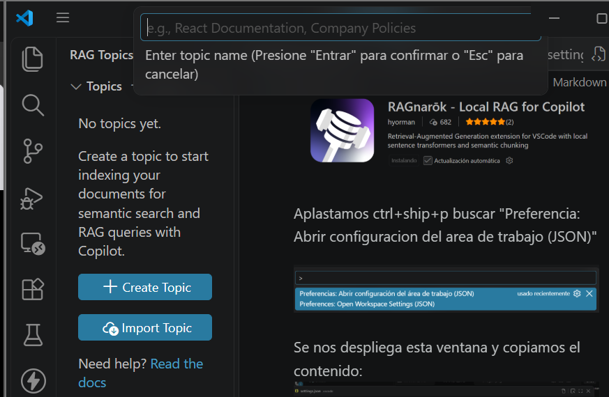


Despues usamos CTRL+SHIP+P para buscar (RAG: Add GitHub Token) y escribimos: 
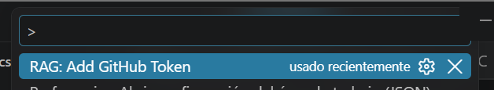
```text
github.com
```
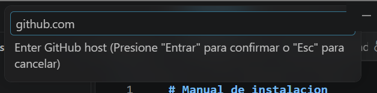
Y aceptamos las configuracines en caso de que salgas. 

Ingresamos a github a sacar el token: 

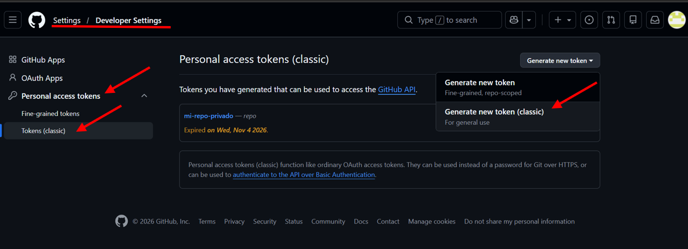

Ingresamos credenciales y solo configuramos para repo:

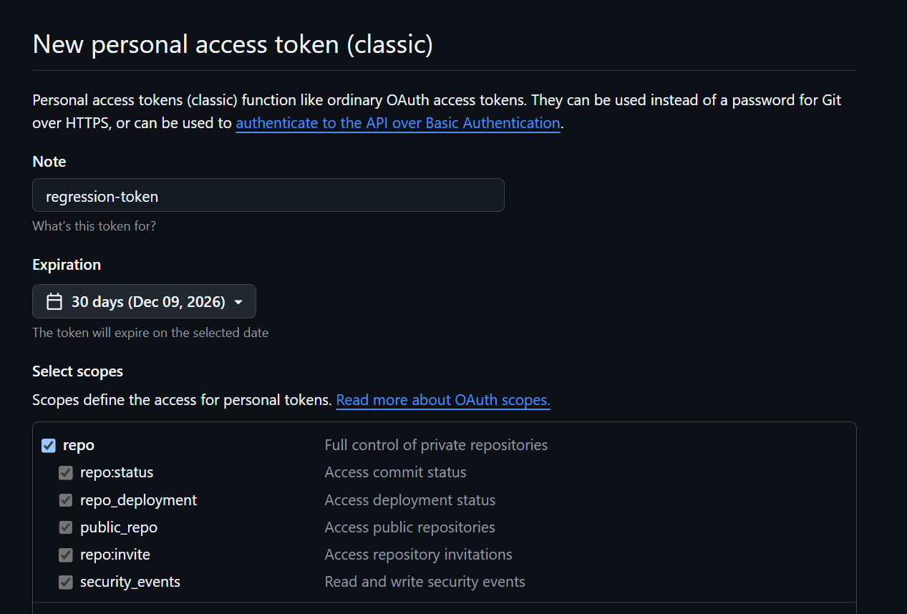

Y le damos a generar token y lo copiamos para poder ponerlo en la parte del token. 

Despues de eso realizamos CTRL+SHIP+P e ingremos: 
```text
RAG: Add Git Repository to Topic.
```
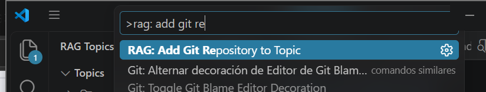
Seleccionamos el repositorio de regression y despues seleccionamos el token que habiamos creado. 
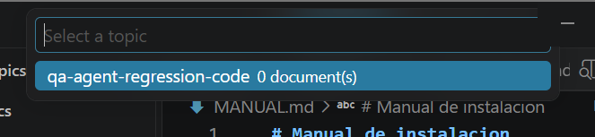
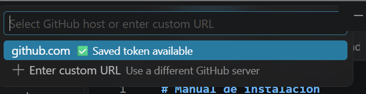
Agregamos la ruta del repositorio git de donde queremos hacer las pruebas: 
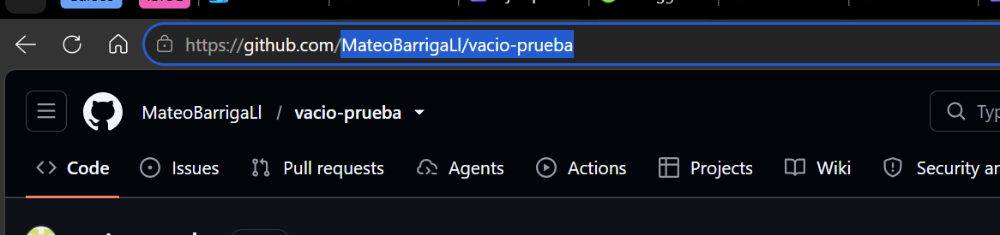

Damos enter y despues ponemos el nombre de la rama donde se va usar. y por ultimo damos enter. 

Verificamos que extraiga los datos:
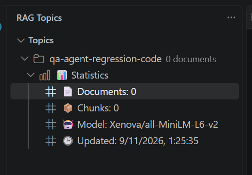

Nos vamos a la raiz del agente en la carpeta de .github ingresamos a standards y vemos el MD de rag-topic-config. Ingresamos y verificamos que el nombre del topic sea el mismo que el que psusimos en el RAG Topics:

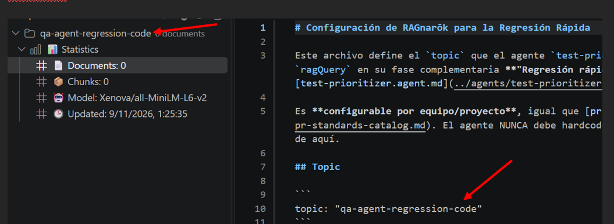

Una ves verificado eso podemos realizar uno del agente por medio del Copilot de VsCode. 
