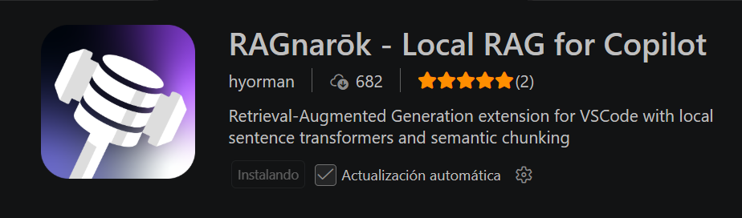
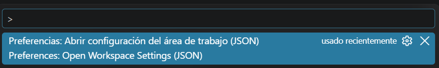
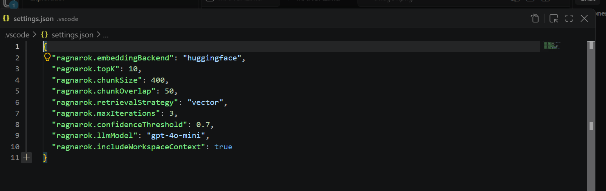
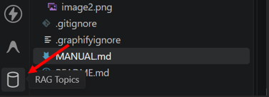

# Manual de instalacion 

Se debe instalar RAGnarōk - Local RAG for Copilot dentro de las extenciones de VsCode. 

Aplastamos ctrl+ship+p buscar "Preferencia: Abrir configuracion del area de trabajo (JSON)"

Se nos despliega esta ventana y copiamos el contenido: 

Vamos a la carpeta de .vscode para aplicar las configuraciones de nuestra ambiente, pegamos lo que anteriomene copiamos. 

Vamos a la parte de nuestras extenciones y abrimos RAG Topics 

